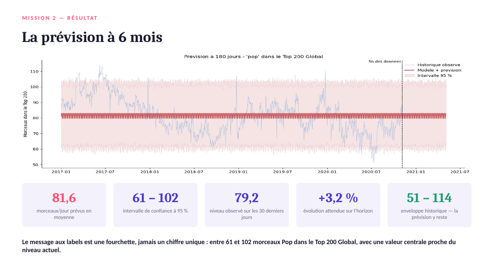

# Analyse et prévision des tendances du streaming musical

> Deux missions pour un comité éditorial musical. La première teste statistiquement ce qui fait la popularité d'un morceau : la réponse est le genre (27 % de la variabilité), pas le son. La seconde prévoit à 6 mois la présence de la Pop dans le Top 200, en jugeant le modèle face à une référence naïve.



**Projet 9 · OpenClassrooms Data Analyst · septembre 2026** · Python · pandas · SciPy (tests non paramétriques) · Prophet · Validation de séries temporelles

---

## Besoin métier
Le comité éditorial de MeloWave, une plateforme fictive, a deux demandes :
1. **Comprendre le catalogue :** les caractéristiques audio sont-elles liées entre elles ? La popularité dépend-elle du genre ? Le contenu explicite dépend-il du genre ?
2. **Anticiper l'activité :** combien de morceaux Pop figureront dans le Top 200 Global au cours des 6 prochains mois, et avec quelle fiabilité ?

## Données
- **Mission 1 :** 114 000 morceaux, 114 genres, 20 variables audio (jeu Spotify Tracks).
  - 450 doublons stricts ont été supprimés.
  - 16 299 morceaux rattachés à plusieurs genres ont été **conservés** : c'est la maille du jeu de données, et leurs caractéristiques audio sont identiques d'une occurrence à l'autre.
- **Mission 2 :** 9,8 millions de lignes de classements Top 200 (2017–2020), agrégées en une série quotidienne de 1 405 points.
  - 5 discontinuités de collecte ont été traitées comme **valeurs manquantes et non comme des zéros**. Un zéro aurait appris au modèle un effondrement qui n'a jamais eu lieu.

## Démarche
1. **Audit et nettoyage :** distinguer l'erreur (doublon) de la caractéristique du jeu (multi-genres).
2. **Description :** profils sonores par genre et échantillon stratifié. Comparer les genres est légitime, mesurer leur poids relatif ne l'est pas.
3. **Tests statistiques après vérification des conditions :** Shapiro-Wilk et droites de Henry montrent que 0 variable sur 11 suit une loi normale. D'où le choix de **Spearman, Kruskal-Wallis et χ²**, avec à chaque fois la **taille d'effet**, pas seulement la p-value.
4. **Modélisation (Prophet) :**
   - période de test strictement postérieure à l'entraînement ;
   - réglage par validation croisée sur 9 origines successives ;
   - comparaison systématique à un **modèle naïf saisonnier**.

## Résultats
| Question | Résultat |
|---|---|
| Lien entre énergie et intensité sonore | ρ = 0,75 (Spearman), mais la popularité n'est corrélée à **aucune** variable audio |
| Popularité selon le genre | Kruskal-Wallis H = 30 955 ; le genre explique **27,2 %** de la variabilité (ε²) |
| Contenu explicite selon le genre | χ² = 18 362, V de Cramér = **0,40** (association forte) |
| Prévision Pop à 6 mois | **81,6 morceaux/jour** en moyenne, intervalle à 95 % de [61 ; 102] |
| Erreur du modèle retenu (test) | MAE de 7,4 morceaux/jour (10 % d'erreur) ; couverture de l'intervalle 100 % |

**Résultat assumé : le modèle naïf saisonnier fait mieux en erreur ponctuelle** (MAE 4,9). Prophet n'a été retenu, dans sa configuration à tendance plate, que pour son **intervalle de confiance fiable**. Sur 21 configurations testées, seules 3 respectaient le critère de couverture.

## Recommandations aux labels
- Ne pas chercher le hit en optimisant les paramètres audio : travailler le positionnement de genre.
- Exploiter les taux de contenu explicite par genre pour la distribution et les playlists sous contrainte.
- **Éviter de sortir un titre Pop majeur un vendredi :**
  - le vendredi est un creux pour la Pop (79,9 morceaux contre 82,9 en milieu de semaine) ;
  - le classement est de taille fixe et les nouveautés du vendredi, tous genres confondus, en expulsent des titres.
- Communiquer une **fourchette** et non un chiffre unique.

## Limites
- Prophet prolonge les motifs passés : un changement d'algorithme de la plateforme n'est pas anticipable.
- L'erreur a été mesurée à 90 jours, ce qui en fait un plancher pour un horizon de 180 jours.
- La tendance plate produit un intervalle de largeur constante, qui sous-estime l'incertitude lointaine.

## Compétences mobilisées
`Python` · `pandas` · `SciPy` · `Tests non paramétriques` · `Tailles d'effet` · `Prophet` · `Backtesting` · `Data storytelling`

## Contenu
```
notebooks/
  0_audit_nettoyage_mission1.ipynb
  Cabart_Leo_1_notebook_analyse_exploratoire_092026.ipynb   # mission 1 : description et tests
  Cabart_Leo_2_notebook_series_temporelles_092026.ipynb     # mission 2 : série, Prophet, backtest
scripts/agregation_mission2.py      # 9,8 M de lignes → séries quotidiennes
data/                               # séries agrégées (entrées du notebook 2)
livrables/                          # support de présentation (PDF) et companions
```
Les données brutes (Spotify Tracks Dataset, classements Top 200 de 1,5 Go) ne sont pas versionnées. Le notebook 2 tourne sur les séries agrégées de `data/` (`pip install pandas prophet matplotlib`).

---
Leo Cabart · Data Analyst · [Portfolio](https://lcabart21.github.io) · [GitHub](https://github.com/lcabart21)
